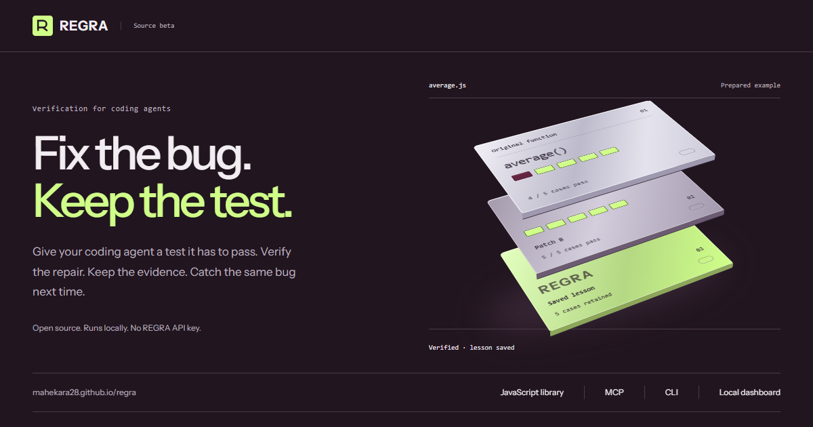

# REGRA

**Verification and regression memory for coding agents.**

Check proposed repairs against reproducible tests. Keep verified function lessons and inspect the evidence behind repository changes.

[Interactive demo](https://mahekara28.github.io/regra/) · [Quick start](#quick-start) · [Agent setup](#connect-an-agent) · [Repository checks](#verify-a-repository) · [API](docs/API.md)

[](https://mahekara28.github.io/regra/)

**Source beta · 0.2.0-beta.1 · Node.js 22.13+ · MIT**

## Why REGRA?

An agent fixes an empty-input crash by returning zero for every input. The crash is gone, but ordinary inputs are now wrong. REGRA rejects that patch because the existing checks fail.

For supported functions, a verified repair becomes a saved lesson that later changes can be checked against. For Node repositories, REGRA compares two committed revisions and records the tests, failures and decision.

## Quick start

Requires **Node.js 22.13+ and Git**. Install this beta from source:

```sh
npm install --global github:mahekara28/regra
```

Then run these commands **inside an existing project folder**:

```sh
regra init --root . --demo
regra demo --root .
regra ui --root .
```

The demo verifies a prepared repair and saves its evidence. Open [the local dashboard](http://127.0.0.1:4317) to inspect results and try the examples. Stop it with Ctrl+C. The dot means your current folder; REGRA does not create a new project directory.

No REGRA account, API key or model is required. Your coding agent keeps its own provider costs.

<details>
<summary>Install from a local clone</summary>

```sh
git clone https://github.com/mahekara28/regra.git
cd regra
npm ci
npm install --global .
```

Already cloned? Run the last two commands from your REGRA checkout.

</details>

## Connect an agent

After initializing your project, run:

```sh
regra connect --client cursor --root .
regra doctor --root .
```

Use `cursor`, `claude`, `codex` or `vscode`. Restart the agent in that project, accept its normal MCP trust prompt, and ask:

> Call regra_status and regra_context. Review the average case, then verify the original and fixed functions in regra-examples using its caseFile and caseHash. Show the decision and proof ID.

The agent starts REGRA over local MCP; the dashboard can stay closed. For your own cases, omit `--demo` during initialization and review the expected behavior before verifying a repair.

[Connection guide](docs/CONNECTIONS.md) covers configuration files, connection checks and disconnecting.

## Verify a repository

In a Git project with a committed `node --test` suite, inspect and preview first:

```sh
regra inspect --root .
regra repo-verify --root . --baseline main --candidate HEAD --dry-run
```

Replace `main` with the broken revision and `HEAD` with the proposed fix. Both refs must exist locally; uncommitted edits are excluded.

After reviewing the plan and trusting the selected code:

```sh
regra repo-verify --root . --baseline main --candidate HEAD --trusted
regra repo-evidence --id YOUR_PROOF_ID --json
```

Use the proof ID printed by verification. REGRA runs the same frozen test suite three times per revision in fresh snapshots. Snapshots protect the checkout from ordinary test writes; **they are not a security sandbox**.

Use `repo-check` instead of `repo-verify` for a regression check that does not require a previously failing test. The MCP tool `regra_repository` exposes read-only inspection, planning and evidence; repository execution uses the CLI or library.

[Repository guide](docs/REPOSITORIES.md) covers dependency installation, supported projects and proof records.

## Use the library

Add REGRA to your Node project:

```sh
npm install --save-dev github:mahekara28/regra
```

Save as `check-regra.mjs` and run `node check-regra.mjs`:

```js
import { createRegra } from '@mahekara28/regra';

const regra = createRegra({ project: 'my-app' });
const proof = await regra.verify({
  spec: {
    entry: 'average',
    title: 'Empty input returns zero',
    repro: { name: 'Empty', args: [[]], expect: 0 },
    checks: [{ name: 'Numbers', args: [[2, 4]], expect: 3 }]
  },
  before: 'function average(xs) { return xs.reduce((a, b) => a + b) / xs.length; }',
  after: 'function average(xs) { return xs.length ? xs.reduce((a, b) => a + b, 0) / xs.length : 0; }'
});

console.log(proof.status); // verified
```

Verified function lessons persist in `.regra/`. Retrieve them with `regra.context()` and replay them with `regra.check()`. Add `.regra/` to `.gitignore` if you skip `regra init`. TypeScript declarations are included.

[API reference](docs/API.md) · [Runnable example](examples/library.mjs)

## Verification rules

A repair must reproduce the original failure, fix it while preserving passing behavior, and produce consistent results across three runs.

| Decision | Meaning |
| --- | --- |
| **Verified** | The recorded acceptance checks passed. |
| **Rejected** | The proposed repair fails a behavior check. |
| **Inconclusive** | Setup, reproduction or repeatability could not establish a valid result. |

Tests cover their recorded behavior. REGRA does not retrain the model, apply patches or guarantee unseen cases. MCP makes verification available; a required CI check enforces it.

## Current scope

| Mode | Supported today |
| --- | --- |
| Function verification | Synchronous, self-contained JavaScript declarations with JSON values or named thrown errors. No imports, exports or promises. Verified lessons can be retained and replayed. |
| Repository verification | Committed, standalone JavaScript projects using `node --test`, including imports and exports. Proofs are saved separately from function lessons. |

Jest, Vitest, TypeScript loaders, Python, browser-test adapters and monorepos are not supported yet. Reusable repository lessons and automatic hook/workflow installation are [planned](docs/IMPLEMENTATION_PLAN.md).

Evidence stays in the project's `.regra/` directory, which `regra init` adds to `.gitignore`. Commit reviewed contracts in `regra-cases/`; inspect evidence before exporting it. Use reviewed code locally.

## Develop

```sh
npm ci
npm test
npm run typecheck
npm run test:package
```

For the public website, run `npm run site:preview` and open [the preview](http://127.0.0.1:4318/regra/). Its prepared examples run in the browser and reset on reload.

[Validation](docs/VALIDATION.md) · [Website guide](docs/WEBSITE.md) · [Roadmap](docs/IMPLEMENTATION_PLAN.md) · [Release guide](docs/RELEASING.md) · [Report an issue](https://github.com/mahekara28/regra/issues)

[MIT license](LICENSE) · Built by [Mahek Ara](https://github.com/mahekara28)
