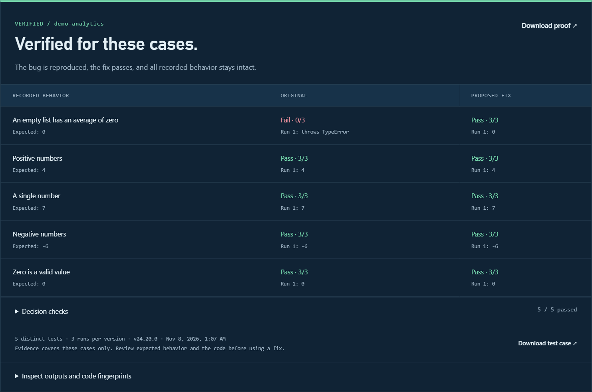

# REGRA

**Prove the fix. Keep the test.**

Local verification and regression memory for coding agents. Check a repair, inspect its evidence, and replay saved function tests on the next change.

[](https://github.com/mahekara28/regra/actions/workflows/ci.yml)

**[Source beta · 0.2.0-beta.1](package.json) · Node.js 22.13+ · [MIT](LICENSE)**

[Try the demo](https://mahekara28.github.io/regra/) · [Install](#quick-start) · [Connect an agent](#connect-an-agent) · [Library](#use-the-library) · [Repositories](#verify-a-repository)



*Actual local execution of the bundled average example. [Explore the workbench](https://mahekara28.github.io/regra/#main).*

## Why REGRA?

An agent fixes an empty-input crash by returning zero for every input. Ordinary inputs are now wrong. REGRA catches the incomplete repair by running both the failing case and existing behavior checks.

| Step | What REGRA does |
| --- | --- |
| **Reproduce** | Run a reviewed test against the original code and confirm the failure. |
| **Verify** | Check the repair and existing behavior across three runs per version. |
| **Record** | Save the decision, observed outputs and code fingerprints locally. |
| **Replay** | Retain verified function cases and check later changes against them. |

Use the same engine from a **JavaScript library, CLI, MCP connection or local dashboard**. Repository checks compare committed revisions and save separate proof records.

## Quick start

Requires **Node.js 22.13+ and Git**. From an **existing project folder**, install the source beta and run the prepared example:

```sh
npm install --global github:mahekara28/regra
regra init --root . --demo
regra demo --root .
regra ui --root .
```

Open [localhost:4317](http://127.0.0.1:4317) to inspect the saved proof and try other repairs. Stop the server with Ctrl+C. `--root .` means the current folder; REGRA does not create the project directory.

**No REGRA account, API key or model required.** Your coding agent keeps its own provider costs.

<details>
<summary>Install from a local clone</summary>

```sh
git clone https://github.com/mahekara28/regra.git
cd regra
npm ci
npm install --global .
```

</details>

## Connect an agent

From your initialized project:

```sh
regra connect --client cursor --root .
regra doctor --root .
```

Choose `cursor`, `claude`, `codex` or `vscode`. Restart the agent in that project, accept its MCP trust prompt, and ask:

> Call regra_status and regra_context. Review the average case. Use its caseFile and caseHash to verify the original and fixed functions in regra-examples. Show the decision and proof ID.

The agent starts REGRA over local MCP; no dashboard server is needed. For your own cases, omit `--demo` and review the expected behavior before verification.

[Client configuration and troubleshooting](docs/CONNECTIONS.md)

## Verify a repository

For a Git project with a committed `node --test` suite:

```sh
regra inspect --root .
regra repo-verify --root . --baseline main --candidate HEAD --dry-run
```

Replace `main` with the broken revision and `HEAD` with the proposed fix. Both must exist locally; uncommitted edits are excluded.

Review the plan, then explicitly trust the selected code to execute it:

```sh
regra repo-verify --root . --baseline main --candidate HEAD --trusted
regra repo-evidence --id YOUR_PROOF_ID --json
```

Use the printed proof ID. Both revisions run the same frozen test suite three times in fresh snapshots. Snapshots protect the checkout from ordinary test writes; **they are not a security sandbox**.

Use `repo-check` for regression checks without a previously failing test. The MCP tool `regra_repository` provides read-only inspection, planning and evidence; execute repository checks through the CLI or library.

[Dependency installation, supported projects and proof records](docs/REPOSITORIES.md)

## Use the library

Add REGRA to your Node project:

```sh
npm install --save-dev github:mahekara28/regra
```

Save as `check-regra.mjs` and run `node check-regra.mjs`:

```js
import { createRegra } from '@mahekara28/regra';

const regra = createRegra({ project: 'my-app' });
const proof = await regra.verify({
  spec: {
    entry: 'average',
    title: 'Empty input returns zero',
    repro: { name: 'Empty', args: [[]], expect: 0 },
    checks: [{ name: 'Numbers', args: [[2, 4]], expect: 3 }]
  },
  before: 'function average(xs) { return xs.reduce((a, b) => a + b) / xs.length; }',
  after: 'function average(xs) { return xs.length ? xs.reduce((a, b) => a + b, 0) / xs.length : 0; }'
});

console.log(proof.status); // verified
```

Retrieve saved lessons with `regra.context()` and replay them with `regra.check()`. TypeScript declarations are included.

[API reference](docs/API.md) · [Runnable example](examples/library.mjs)

## Verification rules

A repair must reproduce the failure, preserve passing behavior and produce consistent results across three runs.

| Decision | Meaning |
| --- | --- |
| **Verified** | The recorded acceptance checks passed. |
| **Rejected** | The proposed repair fails a behavior check. |
| **Inconclusive** | Setup, reproduction or repeatability could not establish a valid result. |

Verification covers the recorded cases. REGRA does not retrain models, apply patches or guarantee unseen behavior. Use a required CI check when verification must block a merge.

## Current scope

| Mode | Supported today |
| --- | --- |
| Functions | Synchronous, self-contained JavaScript declarations. JSON values or named thrown errors; no imports, exports or promises. Saved lessons can be replayed. |
| Repositories | Committed, standalone JavaScript projects using `node --test`, including imports and exports. Proofs are separate from function lessons. |

Jest, Vitest, TypeScript loaders, Python, browser-test adapters and monorepos are not supported yet. Reusable repository lessons and automatic hook/workflow installation are [planned](docs/IMPLEMENTATION_PLAN.md).

Evidence stays in `.regra/`. `regra init` adds it to `.gitignore`; add it yourself when using only the library. Commit reviewed contracts in `regra-cases/` and inspect evidence before exporting it.

## Develop

```sh
npm ci
npm test
npm run typecheck
npm run test:package
```

Preview the public website with `npm run site:preview` at [localhost:4318/regra](http://127.0.0.1:4318/regra/). Its browser examples reset on reload.

[Validation](docs/VALIDATION.md) · [Website guide](docs/WEBSITE.md) · [Roadmap](docs/IMPLEMENTATION_PLAN.md) · [Release guide](docs/RELEASING.md) · [Report an issue](https://github.com/mahekara28/regra/issues)

[MIT license](LICENSE) · Built by [Mahek Ara](https://github.com/mahekara28)
