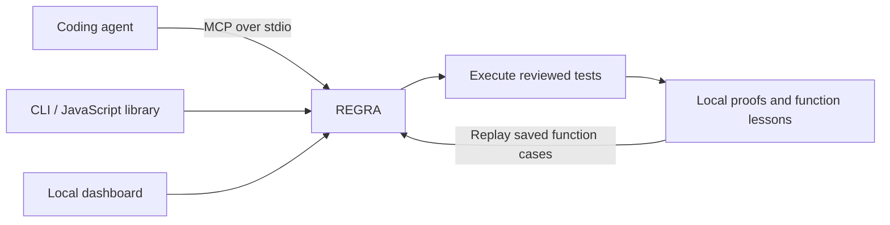

# REGRA

**Prove the fix. Keep the test.** A local verification library for AI coding agents: check repairs, inspect the evidence, and replay tests from verified function fixes.


*Actual execution of the bundled average example. Current source beta: `0.2.0-beta.1`.*

<p align="center">
  <a href="https://github.com/mahekara28/regra/actions/workflows/ci.yml"></a>
  · <a href="package.json">Node.js 22.13+</a> · <a href="LICENSE">MIT</a>
</p>

<p align="center">
  <a href="https://mahekara28.github.io/regra/">Website &amp; interactive demo</a> · <a href="#why-regra">Why REGRA</a> · <a href="#quick-start">Install</a> · <a href="#the-workflow">Workflow</a> · <a href="#where-mcp-fits">Architecture</a> · <a href="#use-the-library">Library</a> · <a href="#verification-rules">Verification</a>
</p>

## Why REGRA?

An agent fixes an empty-input crash by returning zero for every input. Ordinary inputs are now wrong. A later session may repeat the same mistake.

**REGRA turns reviewed failure cases into executable checks.** It runs both versions against the same expectations.

- **Challenge the repair.** Reproduce the bug and preserve existing behavior.
- **Inspect the evidence.** See outputs, failures and code fingerprints.
- **Keep the lesson.** Replay function cases across agents and sessions.

Your agent proposes code; REGRA checks it.

## Quick start

**Node.js 22.13+ · Git · no REGRA account or model API key required**

Install from GitHub and run the prepared example **inside an existing project folder**:

```sh
npm install --global github:mahekara28/regra
regra init --root . --demo
regra demo --root .
regra ui --root .
```

Open [localhost:4317](http://127.0.0.1:4317) to inspect results. `--root .` means your existing current folder. Stop the server with Ctrl+C.

The library, CLI, MCP server and dashboard are included; no frontend build is needed. Your agent keeps its own provider costs.

<details>
<summary>Install from a local clone</summary>

```sh
git clone https://github.com/mahekara28/regra.git
cd regra
npm ci
npm install --global .
```

</details>

## The workflow

| Step | What happens |
| --- | --- |
| **1. Review** | Define the failing case's expected result and existing behavior to preserve. |
| **2. Verify** | Run the original and proposed code against that contract three times per version. |
| **3. Inspect** | Read the decision and before/after results. |
| **4. Reuse** | Retain verified function cases and replay them on later changes. |

Repository checks use frozen committed tests and save separate proofs. Durable repository-lesson replay is planned.

## Where MCP fits



The library runs verification; MCP exposes it to agents, and the dashboard provides a workbench. All share local project storage. Function checks work through each interface; repository execution uses the CLI or library.

### Connect an agent

From your initialized project:

```sh
regra connect --client cursor --root .
regra doctor --root .
```

| Client | `--client` | Project configuration |
| --- | --- | --- |
| Cursor | `cursor` | `.cursor/mcp.json` |
| Claude Code | `claude` | `.mcp.json` |
| Codex | `codex` | `.codex/config.toml` |
| VS Code | `vscode` | `.vscode/mcp.json` |

Restart the agent in that project, accept its normal MCP trust prompt, and ask:

> Call regra_status and regra_context. Review the average case. Use its caseFile and caseHash to verify the original and fixed functions in regra-examples. Show the decision and proof ID.

The agent starts REGRA without a dashboard server. Other client settings are preserved. Omit `--demo` for your own reviewed cases. [Connection guide](docs/CONNECTIONS.md)

## Use the library

Install in your Node project:

```sh
npm install --save-dev github:mahekara28/regra
```

Save as `check-regra.mjs` and run `node check-regra.mjs`:

```js
import { createRegra } from '@mahekara28/regra';

const regra = createRegra({ project: 'my-app' });
const proof = await regra.verify({
  spec: {
    entry: 'average',
    title: 'Empty input returns zero',
    repro: { name: 'Empty', args: [[]], expect: 0 },
    checks: [{ name: 'Numbers', args: [[2, 4]], expect: 3 }]
  },
  before: 'function average(xs) { return xs.reduce((a, b) => a + b) / xs.length; }',
  after: 'function average(xs) { return xs.length ? xs.reduce((a, b) => a + b, 0) / xs.length : 0; }'
});

console.log(proof.status); // verified
```

Retrieve lessons with `regra.context()`; replay with `regra.check()`. TypeScript declarations included. [API](docs/API.md) · [Example](examples/library.mjs)

## Verify a repository

For a committed `node --test` project:

```sh
regra inspect --root .
regra repo-verify --root . --baseline main --candidate HEAD --dry-run
```

Use your broken and fixed revisions in place of `main` and `HEAD`. Both must exist locally; uncommitted edits are excluded. Review the plan, then execute trusted code:

```sh
regra repo-verify --root . --baseline main --candidate HEAD --trusted
regra repo-evidence --id YOUR_PROOF_ID --json
```

Use the printed proof ID. Both revisions run the frozen suite in fresh snapshots. `repo-check` checks regressions without requiring an earlier failure. The `regra_repository` MCP tool provides read-only inspection, planning and evidence. [Repository guide](docs/REPOSITORIES.md)

## Verification rules

| Decision | Meaning |
| --- | --- |
| **Verified** | The failure was reproduced, the repair passed, and existing behavior held across repeated runs. |
| **Rejected** | The candidate fails a recorded behavior check. |
| **Inconclusive** | Setup, reproduction or repeatability could not establish a valid result. |

Regression-only checks require passing tests without claiming a repair. A verified result applies to the recorded tests; REGRA does not retrain models or guarantee untested behavior. For enforcement, run verification as a required CI check.

Tests cover incomplete repairs, recurrence, changed contracts, setup errors, timeouts, unstable results, client configuration and real MCP calls. Package checks exercise fresh installation, CLI, API and TypeScript declarations. [Validation record](docs/VALIDATION.md)

## Supported today

| Mode | Scope |
| --- | --- |
| Functions | Synchronous, self-contained JavaScript declarations. JSON values or named thrown errors; no imports, exports or promises. Lessons can be saved and replayed. |
| Repositories | Committed, standalone JavaScript projects using `node --test`, including imports and exports. Separate proof records. |

Jest, Vitest, TypeScript loaders, Python, browser tests and monorepos need later adapters. Repository lesson replay and automatic hook/workflow setup are on the [roadmap](docs/IMPLEMENTATION_PLAN.md).

## Local by default

Evidence stays in `.regra/`, which `regra init` adds to `.gitignore`. Add it yourself when using only the library. Commit reviewed contracts in `regra-cases/` and inspect evidence before exporting it. The dashboard listens on `127.0.0.1`.

REGRA executes code on your computer. Use reviewed source: Node permissions and disposable snapshots are **not a security sandbox**.

## Develop

```sh
npm ci
npm test
npm run typecheck
npm run test:package
```

Source: [`src/`](src/) · Dashboard: [`public/`](public/) · Website: [`site/`](site/). Preview with `npm run site:preview` at [localhost:4318/regra](http://127.0.0.1:4318/regra/).

[Website guide](docs/WEBSITE.md) · [Release guide](docs/RELEASING.md) · [Report an issue](https://github.com/mahekara28/regra/issues)

[MIT license](LICENSE) · Built by [Mahek Ara](https://github.com/mahekara28)
